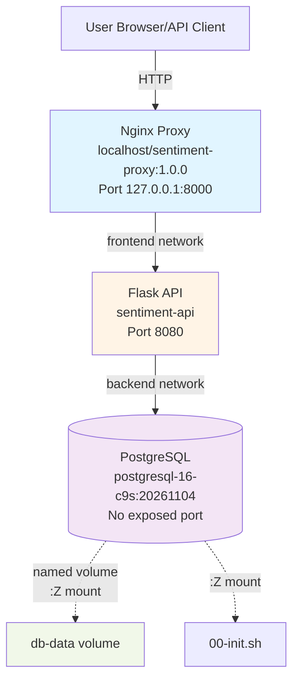
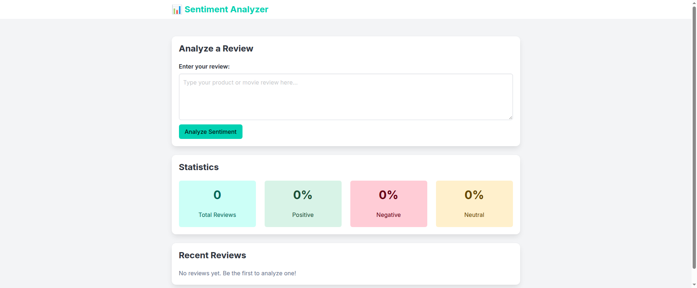
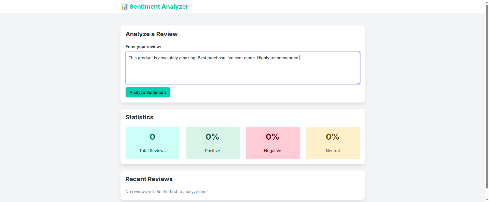
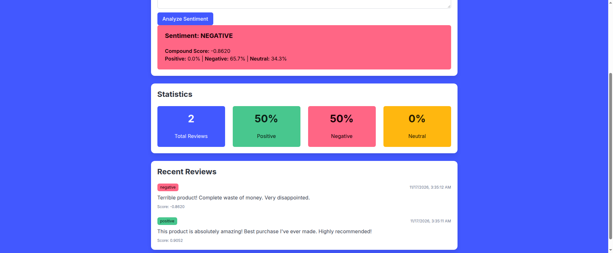
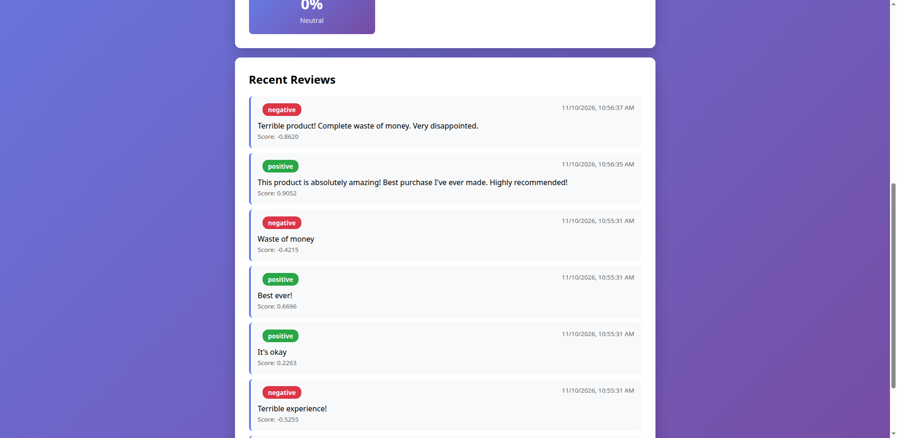

# Sentiment Analyzer for Reviews

A containerized Python web application for sentiment analysis of product and movie reviews, built as a Red Hat DO188/EX188 course project demonstrating Podman and container technologies.

## Overview

This application provides a web interface and REST API for analyzing the sentiment of text reviews using the VADER (Valence Aware Dictionary and sEntiment Reasoner) lexicon-based sentiment analysis tool. Results are stored in PostgreSQL and statistics are displayed showing positive/negative/neutral percentages.

### Features

- 🎯 Simple, clean web UI for submitting and analyzing reviews
- 🔌 REST API for programmatic access
- 📊 Real-time sentiment statistics (positive/negative/neutral percentages)
- 💾 PostgreSQL database for persistent storage
- 🐋 Fully containerized with Podman
- 🔒 Security-focused (rootless, non-root user, secrets management)
- 📦 Multi-stage builds with Red Hat Universal Base Images (UBI)

## Architecture



### Network Topology

The application uses **two separate networks** to implement defense-in-depth:

- **frontend network**: Connects proxy ↔ API
- **backend network**: Connects API ↔ database

The proxy (and thus external users) cannot reach the database directly - all database access must go through the API tier.

## Quick Start

### Prerequisites

- **Podman 5.x** (rootless mode recommended; 4.9+ works with caveats)
- podman-compose 1.6+
- Python 3.11+ (for local testing)
- **systemd user session with loginctl enable-linger** (required for healthcheck timers)

**Important Notes:**
- This project targets Podman 5.x with proper network isolation. Podman 4.9 works but lacks some isolation features.
- Podman healthchecks require systemd user timers. Without them, `depends_on: service_healthy` will hang indefinitely.
- Enable persistent user services: `loginctl enable-linger $USER` (then log out/in or reboot)
- Alternatively, wrap `make up` in `timeout 180` to prevent indefinite hangs.

### Option 1: Using podman-compose (Recommended)

```bash
# 1. Clone and setup
git clone https://github.com/IstoMan/Sentiment.git
cd Sentiment
make setup

# 2. Edit .env file with your configuration (optional)
vi .env

# 3. Start all services
make up

# 4. Access the application
# Web UI: http://127.0.0.1:8000
# API: http://127.0.0.1:8000/api
```

### Option 2: Manual Podman Commands

```bash
# 1. Setup environment and secret
cp .env.example .env
./scripts/setup-secret.sh

# 2. Run manual setup script
./scripts/manual-setup.sh

# 3. Access the application
# Web UI: http://127.0.0.1:8000
```

## API Usage

### Analyze a Review

```bash
curl -X POST http://127.0.0.1:8000/api/analyze \
  -H "Content-Type: application/json" \
  -d '{"text": "This product is amazing! I love it!"}'
```

Response:
```json
{
  "id": 1,
  "text": "This product is amazing! I love it!",
  "preprocessed": "This product is amazing! I love it!",
  "sentiment": "positive",
  "compound": 0.8516,
  "positive": 0.576,
  "negative": 0.0,
  "neutral": 0.424
}
```

### Get Reviews

```bash
# Get recent reviews (paginated)
curl http://127.0.0.1:8000/api/reviews?limit=10&offset=0
```

### Get Statistics

```bash
# Get sentiment statistics
curl http://127.0.0.1:8000/api/stats
```

Response:
```json
{
  "total_reviews": 42,
  "positive_count": 28,
  "negative_count": 10,
  "neutral_count": 4,
  "positive_percentage": 66.67,
  "negative_percentage": 23.81,
  "neutral_percentage": 9.52,
  "average_compound": 0.3421
}
```

### Health Check

```bash
curl http://127.0.0.1:8000/health
```

## DO188/EX188 Course Concepts Demonstrated

This project demonstrates all required concepts from Red Hat DO188 chapters 3-7:

| Concept | Location | Description |
|---------|----------|-------------|
| **Multi-stage Containerfile** | `Containerfile:3-22, 24-30, 32-79` | Builder stage (Python 3.11) + test stage + runtime stage (UBI minimal) |
| **UBI Base Images** | `Containerfile:3, 32` | Uses `ubi9/python-311:9.8-*` for builder and `ubi-minimal:9.8-*` for runtime |
| **Non-root USER** | `Containerfile:61-65, 71` | useradd uid=1001, runs as UID 1001 (appuser) |
| **ARG + ENV with defaults** | `Containerfile:5-6, 34-43` | `${APP_VERSION}`, `${PORT:-8080}` |
| **EXPOSE** | `Containerfile:73` | Port 8080 (>1024 for rootless) |
| **LABEL** | `Containerfile:45-53` | Metadata: name, version, description, maintainer, build-date |
| **Exec-form ENTRYPOINT/CMD** | `Containerfile:78-79` | JSON array format: `["gunicorn"]`, `["--workers", "2", ...]` |
| **Layer caching optimization** | `Containerfile:15-18, 69` | Copy requirements.txt before app code |
| **COPY --from=builder** | `Containerfile:59` | Copy venv from builder stage |
| **Podman secret (file)** | `compose.yaml:10-13, 43-45, 89-91` | DB password via `/run/secrets/db_password` (file) and type=env |
| **Secret consumption in code** | `app/main.py:25-37` | Reads from `DB_PASSWORD_FILE` with fallback |
| **Named volume** | `compose.yaml:14-16, 85-87` | `db-data` for PostgreSQL persistence |
| **Bind mount with :Z** | `compose.yaml:16` | SELinux label for `db/00-init.sh` |
| **Two networks (real isolation)** | `compose.yaml:17-18, 46-48, 68-69, 74-83` | frontend + backend with `isolate` and `internal` options |
| **User-created network with opts** | `scripts/manual-setup.sh:35-38` | Networks with `--opt isolate=true` and `--internal` |
| **depends_on with condition** | `compose.yaml:49-51, 70-71` | Service startup ordering: `service_healthy` |
| **container_name** | `compose.yaml:6, 34, 65` | Named containers for easy reference |
| **ports (127.0.0.1)** | `compose.yaml:66-67` | Rootless-friendly binding to loopback |
| **PostgreSQL UBI image** | `compose.yaml:5` | `quay.io/sclorg/postgresql-16-c9s:20261104` (pinned, no `latest`) |
| **No published DB port** | `compose.yaml:4-25` | Database not exposed to host |
| **Fully qualified tags (no latest)** | `Makefile:4-5, compose.yaml:5, 33, 64` | All base images pinned to specific versions |
| **podman build with args** | `Makefile:49-54, scripts/manual-setup.sh:73-78` | Build with `APP_VERSION` and `BUILD_DATE` |
| **podman run manual** | `scripts/manual-setup.sh:48-61, 83-95, 105-110` | All run parameters explicitly shown |
| **podman network create** | `scripts/manual-setup.sh:36-39` | Manual network setup with isolation |
| **podman secret create** | `scripts/setup-secret.sh:48` | Create secret from stdin |
| **podman volume create** | `scripts/manual-setup.sh:43` | Named volume creation |
| **podman save/load** | `scripts/save-image.sh:14` | Image distribution as tarball |
| **podman generate/kube** | `scripts/generate-kube.sh:14-24` | Export to Kubernetes YAML (handles pods) |
| **pg_dump backup** | `scripts/backup-db.sh:14` | Database logical backup |
| **podman volume export** | `scripts/export-volume.sh:20` | Volume backup as tarball |
| **podman inspect --format** | `Makefile:122-130` | Extract specific JSON fields |
| **podman events** | `Makefile:132-133` | Monitor container events |
| **podman logs -f** | `Makefile:71` | Follow container logs (podman-compose logs -f) |
| **podman port** | `Makefile:143` | Show port mappings |
| **podman exec** | `scripts/backup-db.sh:14, Makefile:136-146` | Execute commands (`ss -pant`, psql) |
| **restart policies** | `compose.yaml:19, 52, 72` | `unless-stopped` for automatic restart |
| **compose healthcheck** | `compose.yaml:20-25, 53-59` | Runtime healthchecks (pg_isready, python http) |
| **HEALTHCHECK in Containerfile** | `Containerfile:75-76` | Native container health check (OCI format note) |

### Additional Concepts Demonstrated

| Concept | Location | Description |
|---------|----------|-------------|
| **registries.conf concepts** | `scripts/push-image.sh` | Fully qualified registry names (quay.io, docker.io) |
| **UBI variants** | `Containerfile:3, 24` | `ubi9/python-311` (full) → `ubi-minimal` (runtime) |
| **Rootless subuid** | Implicit | All commands run rootless (no sudo) |
| **Copy-on-write layers** | `Containerfile` | Optimized layer order for caching |
| **DB env vars on empty volume** | [README § Database Initialization](#database-initialization) | Init script runs on every start (idempotent) |
| **Default network DNS issue** | [README § Network Topology](#network-topology) | User-created networks required for DNS |
| **App binding (0.0.0.0)** | `app/main.py:264, Containerfile:76` | Listen on all interfaces in container |
| **compose up -d/down/down -v** | `Makefile:60, 64, 67` | Detached mode, cleanup, volume cleanup |
| **podman ps** | `Makefile:74` | List containers (podman-compose ps) |
| **podman image prune** | Not scripted | Manual cleanup (mentioned in docs) |
| **Neutral sentiment class** | `app/sentiment.py` | VADER compound -0.05 to 0.05 = neutral |

**Note:** Line numbers are verified by `scripts/check-doc-refs.py` and `make docs-check`.

## Verification & Troubleshooting

### Verify Everything is Running

```bash
# Check container status
podman-compose ps
# OR
podman ps

# Should show 3 containers: sentiment-proxy, sentiment-api, sentiment-db
# All should have STATUS "Up"

# Check health status (Podman 5+)
podman inspect --format='{{.State.Health.Status}}' sentiment-db
podman inspect --format='{{.State.Health.Status}}' sentiment-api
# Should show "healthy" for both
```

### Check Logs

```bash
# Follow all logs
make logs

# Or individual services
podman logs -f sentiment-api
podman logs -f sentiment-db
podman logs -f sentiment-proxy
```

### Check Port Mappings

```bash
# Show published ports
podman port sentiment-proxy

# Expected output:
# 8080/tcp -> 127.0.0.1:8000
```

### Check Network Connectivity

```bash
# Check network connectivity within API container
podman exec sentiment-api curl -s http://localhost:8080/health

# Check listening ports (requires iproute package)
podman exec sentiment-api ss -pant

# Verify network isolation (proxy CANNOT reach DB by IP)
DBIP=$(podman inspect -f '{{(index .NetworkSettings.Networks "sentiment_backend").IPAddress}}' sentiment-db)
echo "DB IP: $DBIP"

# Test from proxy (should FAIL - isolation working)
podman exec sentiment-proxy bash -c "timeout 3 bash -c '</dev/tcp/$DBIP/5432' && echo '✗ REACHABLE (isolation broken!)' || echo '✓ Isolation confirmed: proxy cannot reach DB'"

# Positive control: test from API (should SUCCEED - API needs DB access)
podman exec sentiment-api bash -c "timeout 3 bash -c '</dev/tcp/$DBIP/5432' && echo '✓ API can reach DB (expected)' || echo '✗ API cannot reach DB (problem!)'"
```

### Inspect Containers

```bash
# View full container state
podman inspect sentiment-api

# Extract specific fields
podman inspect --format='{{.State.Status}}' sentiment-api
podman inspect --format='{{.State.Health.Status}}' sentiment-db
podman inspect --format='{{json .NetworkSettings.Networks}}' sentiment-api | python3 -m json.tool
```

### Watch Container Events

```bash
# Monitor real-time container events
make events

# Or directly
podman events --filter container=sentiment-api
```

### Test Database Connection

```bash
# Access database shell
podman exec -it sentiment-db psql -U sentiment_user -d sentiment_db

# Run test query
\dt  # List tables
SELECT COUNT(*) FROM reviews;
\q   # Quit
```

## Common Issues and Solutions

### Issue: Database not initializing

**Symptom**: API can't connect to database, or init script not executed

**Cause**: Database environment variables only apply to an empty volume. If you've started the DB before with different credentials, the old data persists. The init script (`db/00-init.sh`) runs on every start but is idempotent.

**Solution**:
```bash
# Stop and remove containers and volumes
make clean

# Or manually
podman-compose down -v

# Then restart
make up
```

### Issue: `podman-compose` can't find services

**Symptom**: `Error: no such container`

**Cause**: Default Podman network doesn't have DNS

**Solution**: The compose.yaml creates user-defined networks (`frontend` and `backend`) which have built-in DNS. Ensure you're using those networks, not the default.

### Issue: Can't connect to http://localhost:8000

**Symptom**: Connection refused when accessing application

**Cause**: Rootless Podman on some systems doesn't handle IPv6 localhost well

**Solution**: Use `http://127.0.0.1:8000` instead of `http://localhost:8000`

### Issue: :Z mount flag causes errors on non-SELinux systems

**Symptom**: Warnings about SELinux labels on Arch Linux or other non-RHEL systems

**Solution**: The `:Z` flag is a no-op on non-SELinux systems and is safe to keep. It's shown here because it's required practice for the DO188 exam. You can remove `:Z` if it causes issues, but it shouldn't.

### Issue: Permission denied in containers

**Symptom**: Application can't write logs or database can't initialize

**Cause**: Files created on host may have restrictive permissions

**Solution**:
```bash
# Fix permissions for bind mounts
chmod 644 db/00-init.sh
chmod 644 proxy/nginx.conf

# Database volumes should use named volumes (already configured)
```

### Issue: Port already in use

**Symptom**: `Error: address already in use`

**Solution**:
```bash
# Check what's using port 8000
ss -tuln | grep 8000

# Either stop the conflicting service or change the port in compose.yaml:
# ports:
#   - "127.0.0.1:8001:8080"
```

### Issue: Image build fails to download packages

**Symptom**: Network errors during `podman build`

**Solution**:
```bash
# Check network connectivity
curl -I https://registry.access.redhat.com/v2/

# Try with fresh cache
podman build --no-cache -t localhost/sentiment-analyzer:1.0.0 .
```

## Testing

### Run Unit Tests

```bash
# Install test dependencies
pip3 install -r requirements.txt -r requirements-test.txt

# Run all tests
make test

# Run with coverage
make test-cov

# Open coverage report
xdg-open htmlcov/index.html  # Linux
open htmlcov/index.html       # macOS
```

### Run Integration Tests (requires running database)

```bash
# Start all services
make up

# Run integration tests (inside backend network with DB secret)
make test-integration
```

## Backup and Distribution

### Backup and Restore Database

**Logical Backup (pg_dump)**
```bash
# Create backup
make backup
# Creates: backups/sentiment_db_YYYYMMDD_HHMMSS.sql.gz

# Restore from backup
podman stop sentiment-api  # Stop API to prevent connections
zcat backups/sentiment_db_YYYYMMDD_HHMMSS.sql.gz | \
  podman exec -i sentiment-db psql -U sentiment_user -d sentiment_db
podman start sentiment-api
```

**Volume Backup (physical)**
```bash
# Create volume backup
make backup-volume
# Creates: backups/volume_YYYYMMDD_HHMMSS.tar.gz

# Restore from volume backup
podman-compose down -v                          # Stop and remove volumes
podman volume create sentiment_db-data          # Recreate volume
podman volume import sentiment_db-data backups/volume_YYYYMMDD_HHMMSS.tar.gz
podman-compose up -d                            # Start services
```

### Save and Distribute Image

```bash
# Save image as tarball
make save-image

# Copy dist/sentiment-analyzer-1.0.0.tar to target system

# Load on target system
podman load -i sentiment-analyzer-1.0.0.tar
```

### Push to Container Registry

```bash
# Login to registry
podman login quay.io
# or
podman login docker.io

# Tag image with registry
podman tag localhost/sentiment-analyzer:1.0.0 quay.io/yourusername/sentiment-analyzer:1.0.0

# Push
podman push quay.io/yourusername/sentiment-analyzer:1.0.0

# See scripts/push-image.sh for detailed instructions
```

### Generate Kubernetes Manifests

```bash
# Generate from running containers
make generate-kube

# Output in kubernetes/ directory
```

## Development

### Live Development with Volume Mount

Use the development compose overlay for live code reloading:

```bash
# Start with development config
podman-compose -f compose.yaml -f compose.dev.yaml up -d

# Changes to app/*.py will trigger automatic reload
```

Or manually edit `compose.yaml` to add a bind mount:

```yaml
api:
  # ... existing config ...
  volumes:
    - ./app:/app/app:Z
  command: ["--reload", "--bind", "0.0.0.0:8080", "--workers", "1", "app:app"]
  environment:
    - FLASK_DEBUG=1
```

### Manual Development Setup

```bash
# Create virtual environment
python3 -m venv venv
source venv/bin/activate  # Linux/macOS
# or: venv\Scripts\activate  # Windows

# Install dependencies
pip install -r requirements.txt -r requirements-test.txt

# Run locally (requires PostgreSQL running)
export DB_HOST=localhost
export DB_PORT=5432
export DB_NAME=sentiment_db
export DB_USER=sentiment_user
export DB_PASSWORD=yourpassword

flask --app app run --host 0.0.0.0 --port 8080
```

## Cleanup

### Stop Services (Keep Data)

```bash
make down
# or
./scripts/manual-stop.sh
```

### Remove Everything Including Data

```bash
make clean
```

### Remove Images

```bash
# Remove application image
podman rmi localhost/sentiment-analyzer:1.0.0

# Remove all unused images
podman image prune -a
```

## Technology Stack

- **Language**: Python 3.11
- **Web Framework**: Flask 3.1
- **Sentiment Analysis**: VADER (vaderSentiment)
- **Database**: PostgreSQL 16 (CentOS Stream 9 image)
- **Container Runtime**: Podman 5.x (4.9+ compatible with caveats)
- **Base Images**: Red Hat UBI 9
- **Web Server**: Gunicorn
- **Reverse Proxy**: Nginx (UBI 9)
- **Testing**: pytest, pytest-cov

## License

MIT License - See [LICENSE](LICENSE) file for details.

## Course Context

This project is designed for Red Hat DO188 4.18 (Introduction to Containers, Kubernetes, and Red Hat OpenShift) and EX188 exam preparation. It demonstrates practical container skills including:

- Building multi-stage Containerfiles with UBI
- Implementing rootless, non-root container security
- Managing secrets with Podman
- Configuring multi-network architectures
- Using health checks and restart policies
- Backing up and distributing containers
- Troubleshooting containerized applications

## Contributing

This is a course project and not actively maintained, but suggestions for improvements are welcome via issues or pull requests.

## Author

DO188 Course Project - Red Hat Container Technologies

## Screenshots

### Main Application Interface

*Clean, modern UI for sentiment analysis*

### Review Input

*Submit product or movie reviews for analysis*

### Analysis Results

*Real-time sentiment classification with detailed scores*

### Statistics Dashboard  

*Positive/negative percentages and analytics*

### Recent Reviews

*History of analyzed reviews with sentiment labels*

